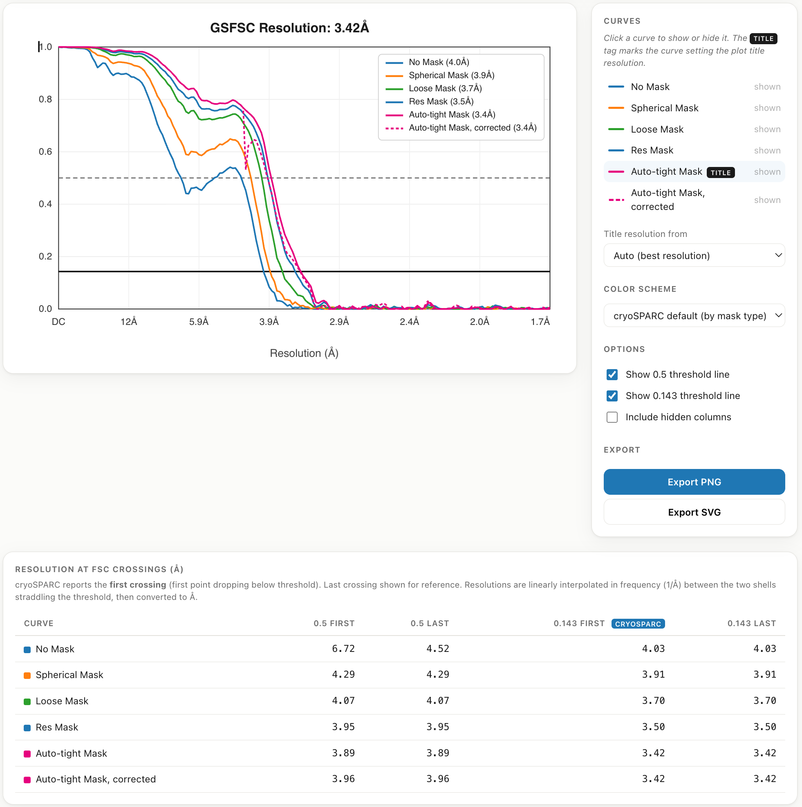

# FSC Plotter: 0.143 and 0.5 resolution table for cryoSPARC FSC curves

Drop in a cryoSPARC `FSC.txt` export and get a table of the **FSC 0.143 and 0.5 resolution
crossings for every masked and unmasked curve**. It can also plot the curves for figures.
It runs in your browser as a single HTML file, so nothing is uploaded or installed.

**Try it:** https://ajitr66.github.io/fsc-plotter/

## Resolution table

One row per curve: **No Mask** (unmasked), **Spherical**, **Loose**, **Tight**, **Res**,
**Auto-tight** and **Auto-tight corrected**. Phase-randomized curves are included if you tick
*Include hidden columns*.

| Column | Meaning |
| --- | --- |
| **0.143 first** | Gold-standard (GSFSC) resolution, the value cryoSPARC reports |
| **0.5 first** | Conservative estimate, also used for map-vs-model FSC |
| **last** columns | Last crossing, which shows whether a curve dips and recovers |

Values are in Å, linearly interpolated in frequency between the two shells either side of the threshold.

## Plotting

- FSC curves with optional 0.5 and 0.143 threshold lines, and a cryoSPARC-style
  `GSFSC Resolution` title
- Preset color schemes, or **Custom** colors and line styles for each curve
- PNG and SVG export

## Input

Both cryoSPARC export layouts work. If a file has only `wave_number` and no `frequency` column,
you'll be asked for the box size and pixel size. The [`examples/`](examples) folder has one of each:

- [`fsc_with_frequency.txt`](examples/fsc_with_frequency.txt): includes a `frequency` column
- [`fsc_wave_number_only.txt`](examples/fsc_wave_number_only.txt): `wave_number` only

## Changelog

- **v1.2**: Custom per-curve colors and line styles.
- **v1.1**: Reads `wave_number`-only exports. Labels are inferred from column keys,
  `_raw` columns are hidden by default, and there are x-axis tick options.
- **v1.0**: First release.

## License

MIT, see [LICENSE](LICENSE).
